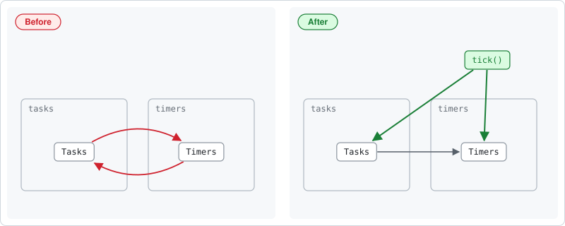
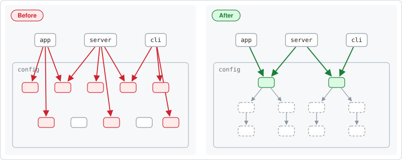

# deslop-please

[](https://github.com/Bor4brn/deslop-please/actions/workflows/ci.yml?query=branch%3Amain)
[](https://github.com/Bor4brn/deslop-please/actions/workflows/ci.yml?query=branch%3Amain)

> A port of [deterministic-machines/deslop-please](https://github.com/deterministic-machines/deslop-please)
> that also checks Python, TypeScript and JavaScript. Its Rust reports are the
> original's, byte for byte, but for SARIF's link to the tool. Rust-only? Use
> the original.

An opinionated linter to remove sloppy code. It follows [*A Philosophy of Software Design*](https://www.amazon.com/Philosophy-Software-Design-John-Ousterhout/dp/1732102201): 
**deep** modules, **narrow** interfaces. 

It checks **Rust**, **Python**, **TypeScript** and **JavaScript** projects, and
every one of them in a monorepo, with the same lints.

```bash
cargo install --git https://github.com/Bor4brn/deslop-please
```

Each language is read from the index its language server's indexer writes:

| Language | Indexer | Install |
| --- | --- | --- |
| Rust | rust-analyzer | `rustup component add rust-analyzer` |
| Python | [scip-python](https://github.com/sourcegraph/scip-python) | `npm install -g @sourcegraph/scip-python` |
| TypeScript, JavaScript | [scip-typescript](https://github.com/sourcegraph/scip-typescript) | `npm install -g @sourcegraph/scip-typescript` |

You only need the indexers of the languages you check. scip-python and
scip-typescript need Node.js 18 or later; a project's own
`node_modules/.bin/scip-typescript` (a devDependency) is used before the one
on `PATH`. If one is missing, `deslop-please` says which and how to install it;
the projects it can read are still checked, so a Rust repository needs only
rust-analyzer, as before.

```bash
> deslop-please

error[field-leak]: `RunQueue::items` is known outside `RunQueue`: 4 places in 2 modules
  --> src/sched/policy.rs:7:1
  = note: src/sched/policy.rs:7:1: `runqueue::sched::policy::admit`
  = note: src/sched/policy.rs:12:1: `runqueue::sched::policy::next`
  = note: src/sched/report.rs:4:1: `runqueue::sched::report::backlog`
  = note: src/sched/report.rs:8:1: `runqueue::sched::report::drained`
    runqueue::queue::ring::RunQueue
      items ◀━┳━ 2  runqueue::sched::policy
              ┗━ 2  runqueue::sched::report
      also known outside: head
      kept: limit

deslop-please: 65535 errors, well done!
```

### Which projects it checks

Run it anywhere:

```bash
deslop-please                       # every language found (--language auto)
deslop-please --language rust       # only the Cargo workspace, as before
deslop-please --language python
deslop-please --language typescript
deslop-please --language javascript
deslop-please api::app.models       # one package or module
```

It finds projects by their manifests, with no change to them: the Cargo
workspace around the current directory or below it; `pyproject.toml`,
`setup.py`, `setup.cfg`, `requirements.txt` or `Pipfile`; `package.json`, or a
`tsconfig.json` outside one. Each package of a monorepo is checked on its own,
so a Next.js frontend and a FastAPI backend in one repository are two
projects, and the paths in the report start from where you ran it:

```bash
> deslop-please
deslop-please: checking backend (python)
deslop-please: checking frontend (typescript)
error[module-cycle]: 2 modules in `api::app` use each other in a circle
  --> backend/app/db.py:6:1
...
error[field-leak]: `Cart::lines` is known outside `Cart`: 1 place in 1 module
  --> frontend/src/app/page.tsx:7:1
```

Dependencies, virtual environments, build output, hidden directories, test
fixtures and generated files (`*.d.ts`, `*.min.js`, `*_pb2.py`, files marked
`@generated` or `DO NOT EDIT`) are not read. Nothing is written into the
projects: Python and TypeScript indexes are cached under `$XDG_CACHE_HOME` (or
`~/.cache`) and rebuilt only when a source file changes. `--target` and
`--features` apply to the Rust project only.

### What each language supports

| Lint | Rust | Python | TypeScript | JavaScript |
| --- | --- | --- | --- | --- |
| `module-cycle` | ✓ | ✓ | ✓ | ✓ (ES modules and `require`) |
| `tangle` | ✓ | ✓ | ✓ | ✓ |
| `field-leak` | ✓ | ✓ | ✓ | partial: class-body fields only |
| `shallow-module` | ✓ | ✓ | ✓ | ✓ |
| `wide-directory`, `long-file` | ✓ | ✓ | ✓ | ✓ |

A module is a Rust module, a Python package or module (`app.store.table`), or
a TypeScript/JavaScript directory or file (`store::table`); `__init__.py` and
`index.ts` are their directory's module, as `mod.rs` is. What the indexers
cannot resolve is not seen: untyped Python and plain JavaScript give fewer
references, and so fewer reports. [docs/languages.md](docs/languages.md)
has each lint's meaning per language, the known limits, and how to add a
language.

### It's not my fault 

Sure, let's just mute them:

```bash
deslop-please --update-allow .deslop-please.allow  
deslop-please --allow .deslop-please.allow 
```

### Add to your `AGENTS.md`

```markdown
-  Run [`deslop-please`](https://github.com/Bor4brn/deslop-please) to check for sloppy code structure.
-  Errors flagged by `deslop-please` must be fixed from first principles, don't do mechanical moves to hide them.
    - `module-cycle` & `tangle`: what is the indented layer of abstraction? Which module should be at which layer?
    - `field-leak` & `shallow-module`: Why we have these fields/functions at all? What are the patterns of use? Can they be hidden behind a narrow interface? Don't fix each leak one at a time, fix them holistically.
    - Draw a diagram to help user understand the before and proposed after structure.
```

## Why they are sloppy 

They are really just one single idea: **deep** modules, **narrow** interfaces.

Deep modules hide the attention for you and your agents, so you only need to care about the narrow interface.

### module-cycle


### tangle



### field-leak


### shallow-module




## License

MIT, as the original: its [LICENSE](LICENSE) and copyright notice are kept.
