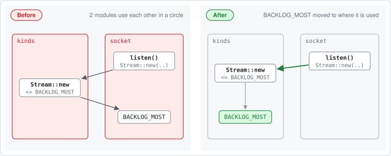
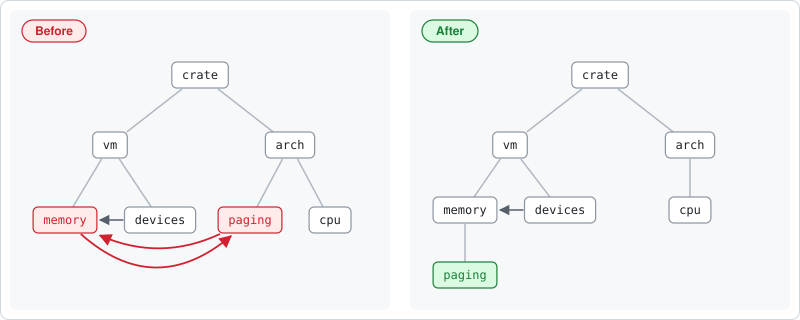
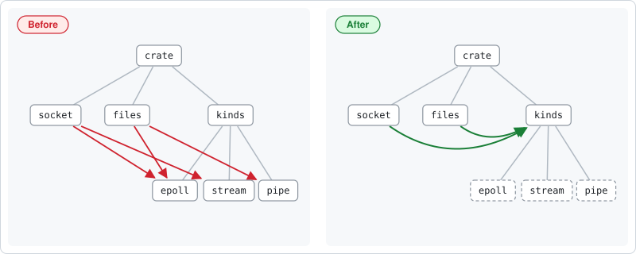
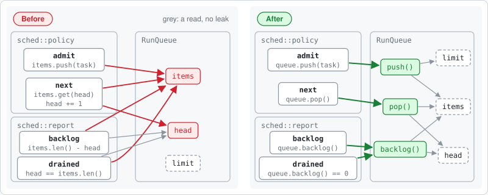
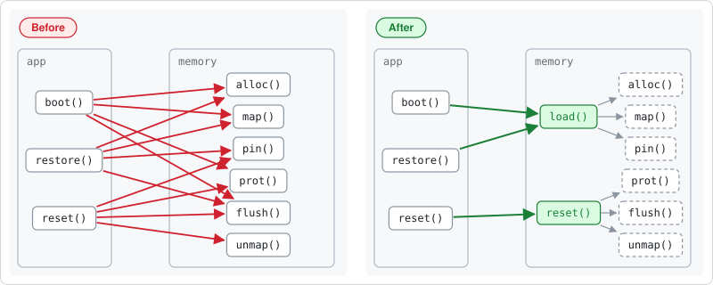

# deslop-please

An opinionated linter to remove sloppy code. 

It follows *A Philosophy of Software Design*: 
**deep** modules, **narrow** interfaces. 


```bash
cargo install deslop-please
```

```bash
> deslop-please [code-I-never-read] 

==================================================

error[module-cycle]: cyclic dependency in `problems`: `kinds` <-> `socket`
  --> src/kinds/stream.rs:1:1
  = note: `kinds` -> `socket` uses only 1 item (Socket); cutting it frees `kinds`, `socket`
  = note: src/kinds/stream.rs:1:1: `kinds` -> `socket` (1 item)
  = note: src/socket.rs:1:1: `socket` -> `kinds` (2 items)

deslop-please: 65535 errors, well done!
```

### It's not my fault 

Sure, let's just mute them:

```bash
deslop-please --update-allow .deslop-please.allow  
deslop-please --allow .deslop-please.allow 
```

### Add to your `AGENTS.md`

```markdown
-  Run [`deslop-please`](https://github.com/deterministic-machines/deslop-please) to check for sloppy code structure.
-  Add `deslop-please` to the CI.
```

## Why they are sloppy 

They are really just one single idea: **deep** modules, **narrow** interfaces.

Deep modules hide the attention for you and your agents, so you only need to care about the narrow interface.

### module-cycle

Sibling modules that use each other in a circle.



### split-module

Two modules in different places that lean on each other so much they are
really one module.



### facade-bypass

Code that reaches past a module into one of its submodules.




### field-leak

Code that reads or writes a field of a struct owned by another module, when
that struct has private fields.



### chatty-seam

One module calling many different functions of another.



### shallow-module

A module where most functions are called from outside.


## License

MIT. See [LICENSE](LICENSE).
